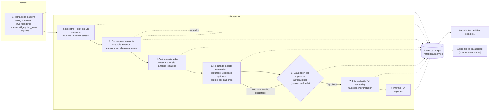

# Diagrama de trazabilidad de la información — LIMS

Este diagrama muestra **cómo fluye toda la información** del laboratorio, desde la toma de la muestra en terreno hasta el informe que recibe el investigador. Para cada etapa indica **qué dato se registra, en qué tabla queda y quién lo firma**.

Es el **diseño** (vale para cualquier muestra). La pestaña **Trazabilidad completa** del detalle de una muestra muestra los **datos reales** de una muestra concreta que recorrió este flujo, y el **Asistente de trazabilidad** (chatbot) responde preguntas sobre esos mismos datos.

## 1. Flujo de la información

## 2. Qué se registra en cada etapa

| # | Etapa | Dato que queda registrado | Tabla(s) | Quién lo registra / firma |
|---|---|---|---|---|
| 1 | Toma en terreno | Sitio georreferenciado (código, lat/lon), punto exacto, fecha y hora de toma, **equipo de toma** (botella Niskin, draga, cuadrante, sonda) y su calibración vigente ese día, investigador que encarga | `sitios_muestreo`, `muestras`, `equipos`, `equipo_calibraciones`, `investigadores` | Investigador (dato) / usuario que registra |
| 2 | Registro | Código único, tipo de muestra, prioridad, observaciones, estado inicial *Recibida*; etiqueta con QR | `muestras`, `muestra_historial_estado` | Usuario de la sesión |
| 3 | Recepción y custodia | Quién entregó, quién recibió (firma), condición, **ubicación de almacenamiento**, cada traslado posterior | `custodia_eventos`, `ubicaciones_almacenamiento` (`muestras.ubicacion_almacenamiento` = ubicación actual) | Quien recibe firma con fecha y hora |
| 4 | Análisis solicitados | Parámetros a medir, método y rango de referencia, analista asignado | `muestra_analisis`, `analisis_catalogo` | Analista / supervisor |
| 5 | Resultado | Valor, en rango o no, puntaje de anomalía, **equipo de laboratorio** con calibración vigente; cada corrección es una **versión nueva** con motivo | `resultados`, `resultado_versiones`, `equipos`, `equipo_calibraciones` | Analista |
| 6 | Evaluación | Aprobación o rechazo de una **versión específica** del resultado, con comentario obligatorio si se rechaza | `aprobaciones` | Supervisor / Administrador |
| 7 | Interpretación | Texto del informe, origen (IA revisada / reglas / manual) y quién lo validó | `muestras.interpretacion*` | Supervisor / Administrador |
| 8 | Informe | PDF emitido, versión y emisor | `reportes` | Supervisor / Administrador |
| — | Estados | Cada cambio de estado con usuario, fecha y motivo | `muestra_historial_estado` | Automático (backend) |

## 3. Reglas que protegen la trazabilidad (ISO/IEC 17025)

- **Nada se sobrescribe:** los resultados se versionan (`resultado_versiones`), las calibraciones se acumulan (`equipo_calibraciones`) y los cambios de estado quedan en `muestra_historial_estado`.
- **Equipo calibrado obligatorio:** el backend rechaza un equipo dado de baja o con la calibración vencida, tanto para la toma en terreno como para medir resultados. Un equipo de terreno no puede usarse para medir en el laboratorio, y al revés.
- **Firma explícita:** cada evento de custodia exige confirmación (`CHECK confirmado = TRUE`).
- **Rechazo justificado:** un rechazo o un resultado fuera de rango exige comentario (`CHECK` en la BD).
- **Aprobación ligada a la versión:** si un resultado se corrige después de un rechazo, la versión nueva vuelve a quedar pendiente.

## 4. Consultar la trazabilidad

- **Pestaña "Trazabilidad completa"** (detalle de la muestra): línea de tiempo de una muestra con todos los hitos anteriores.
- **Asistente de trazabilidad** (menú lateral): preguntas en lenguaje natural, por ejemplo:
  - "¿Dónde está guardada la M-2026-0012 y con qué equipo se tomó?"
  - "¿Qué resultados se midieron con el EQ-005 y estaba calibrado?"
  - "¿Qué muestras se tomaron en Bahía Ilque en marzo?"

  El asistente solo consulta (no modifica datos), usa los mismos datos de la línea de tiempo y muestra qué consultas hizo para cada respuesta.
